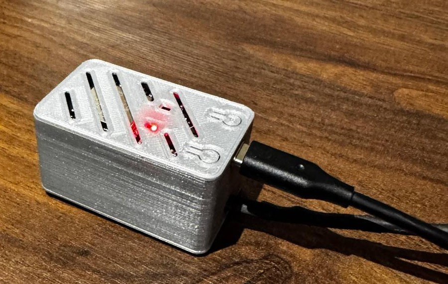
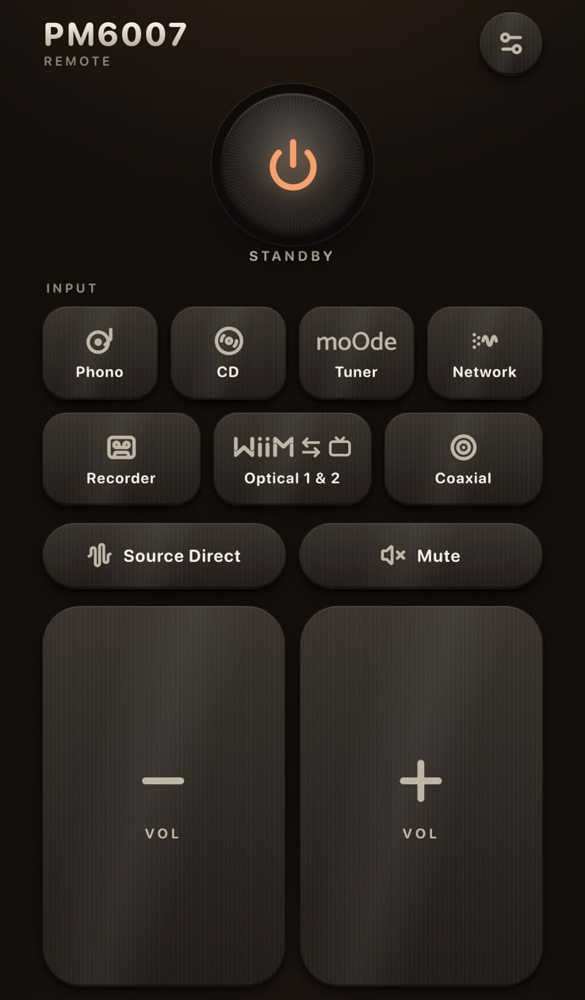
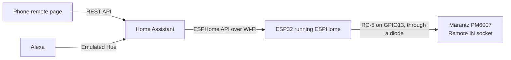
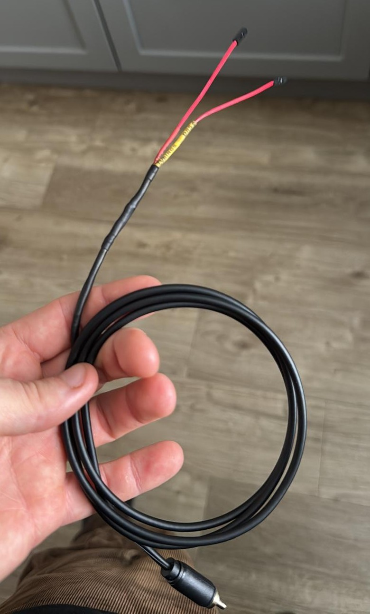

# Marantz PM6007 network remote (ESP32 + ESPHome)

Control a Marantz PM6007 amp from Home Assistant using an ESP32 wired into the amp's Remote IN socket.

The config is in [amp.yaml](esphome/amp.yaml).

 

Left: the controller. Right: the optional phone remote page.

## What it does

It adds 12 buttons to Home Assistant:

- Standby/Wake (toggle)
- Volume up and down (hold)
- Mute
- Source Direct (toggle)
- Phono
- CD
- Recorder
- Tuner
- Network
- Optical (1 and 2 toggle)
- Coaxial

What it can't do:

- Tell you what state the amp is in. The link is one way and Standby is a toggle, so Home Assistant can't know if the amp is on or off - adding a smart plug to read and report power draw may be a way to add this functionality.
- Tell you if Optical 1 or 2 is selected
- Tell you if Source Direct is on or off

## Why

The PM6007 has no network control, and the remote that comes with it is big and only useful if it's within reach. I didn't want to rely on infrared either, because it needs line of sight. I knew the Remote IN socket accepts codes from other Marantz devices, so I looked into that instead.

All my sources use a fixed volume so everything stays consistent, which means volume is set on the amp itself. That used to mean getting up every time I wanted to change it. Sometimes my dog Chief is resting his head on me on the sofa and I don't want to disturb him. Now I can do it from my phone, which is always on me, unlike the remote. It's also handy when I'm cooking, because I can make changes without walking back and forth to the amp, and Alexa works when my hands are full. Basically I'm lazy and walking over to the amp was too much effort.

## How it works



- The Remote IN socket takes the same commands as the infrared remote, but as a plain electrical signal with no infrared carrier
- Marantz use the Philips RC-5 format. Some commands use a longer Marantz version of it and this has been documented below
- An ESP32 sends those signals into the socket through one diode. The diode stops the amp pushing current back into the ESP32. Others reported that the IR remote stopped working when no diode was used.
- ESPHome shows the ESP32 in Home Assistant as a set of buttons

## Hardware

### Parts

- ESP32 dev board (30 pin, CH340, USB-C). A classic ESP32, I used a cheap generic one (https://www.amazon.co.uk/dp/B0D86JDPD6)
- 1N4148 diode. Any normal diode will do. (https://www.amazon.co.uk/dp/B00XWE2SYM)
- KY-022 IR receiver module. Only needed to capture your own remote's codes if mine do not work for you. (https://www.amazon.co.uk/dp/B09SLS7ZW2)
- A spare RCA cable (you will need to cut one plug off)
- Dupont jumper wires for ease. I ended up soldering the female ends to the cable so the board end can be unplugged. These are not the tightest fit so hot glue was used to secure them.
- 3 more jumper wires to connect the KY-022 to the ESP32 (only needed for capturing codes)
- Heat shrink, solder and flux
- Multimeter
- Power for the ESP32
- 3D printed case: [ESP32 Development Case + Wire Passthrough](https://makerworld.com/en/models/692863-esp32-development-case-wire-passthrough) by emergency.assembly on MakerWorld, a remix of [ESP32 Development Case](https://makerworld.com/en/models/412517-esp32-development-case) by JukeSaber. Printed as it is. I haven't included the case files because the designer's licence doesn't allow sharing them. Get them from the link mentioned.

### Tools

- Soldering iron
- Wire strippers
- Glue gun or cable ties for strain relief

## Tech

| Area | What |
| --- | --- |
| Board | Classic ESP32 dev board (30 pin, CH340, USB-C) |
| Firmware | ESPHome with the ESP-IDF framework |
| Signal | RC-5, standard 14 bit and the longer Marantz format, built by a script and sent on GPIO13 through a diode |
| Control | ESPHome template buttons in Home Assistant |
| Phone remote | One HTML file, vanilla JavaScript, calling the Home Assistant REST API |
| Voice | Home Assistant scripts exposed to Alexa through Emulated Hue |
| Code capture | KY-022 IR receiver on GPIO27 and a small Python 3 decoder script |

## Repo layout

<details>
<summary>Show the folder layout</summary>

```
esphome/         the ESPHome config (amp.yaml) and secrets.yaml.example
web-remote/      the phone remote page and the prompt I used to make it
docs/images/     photos and screenshots
```

</details>

## Warnings

- Never connect Remote OUT to the ESP32. The smallhacks blog (first link in the credits below) measured impulses of about 6V on the Remote OUT socket of a PM-62, which might damage the 3.3V board.

## Setup

<details>
<summary>Show the setup steps</summary>

### Before you start

- You'll need Home Assistant running. If you haven't got it, start with the official guide: https://www.home-assistant.io/installation/
- You'll need ESPHome, either the dashboard or the add-on: https://esphome.io
- You'll need a 2.4 GHz Wi-Fi network. The ESP32 can't join 5 GHz
- Once the ESP32 is online it should show up in Home Assistant as a discovered device. It may ask for the API key from your secrets.yaml
- I run both in Docker on a home server. How you install them doesn't matter for this guide, as long as the ESP32 can reach Home Assistant on your network

### Temporary Wiring for the IR receiver

- KY-022 VCC (the middle pin on mine) goes to 3V3
- KY-022 GND (marked with a minus) goes to a GND pin
- KY-022 signal (marked S) goes to D27 (GPIO27)
- Only power it from 3V3, never 5V
- Do this with the board unplugged

### Wiring

- D13 (GPIO13) goes to the plain end of the diode
- GND (the pin next to D13) goes straight to the RCA cable's shield wire, no diode on this one
- The striped end of the diode goes to the RCA cable's centre wire

```
ESP32 D13 ---[ plain end  DIODE  stripe end ]--- RCA centre wire
ESP32 GND ---------------------------------------- RCA shield wire
```

- The stripe on the diode is the cathode and it faces the cable

#### Building the cable

- Cut one plug off the RCA cable and strip about 2 cm of the jacket
- Slide heat shrink onto the centre wire and the diode first
- Twist the shield strands into one wire and tin it
- Solder the diode between the centre wire and one Dupont lead
- Solder the shield wire to a second Dupont lead
- Cover every joint with heat shrink



#### Testing the cable

- Multimeter in diode mode, red probe on the D13 lead and black probe on the plug's centre pin. I got 0.551V
- Swap the probes and it should read open. Mine showed "1"
- If yours is the other way round, the diode is back to front and should be corrected
- In continuity mode the ground lead to the plug's outer sleeve should beep
- Nothing else should beep. The two leads against each other, the centre pin against the sleeve or the D13 lead against the sleeve
- The signal wire won't beep in continuity mode because it goes through the diode. Mine showed about 490.

### Secrets

- amp.yaml reads its passwords from a secrets.yaml file that is not in this repo
- Create one next to amp.yaml:

```yaml
wifi_ssid: "your Wi-Fi name"
wifi_password: "your Wi-Fi password"
amp_api_key: "a 32 byte base64 key"
amp_ap_password: "a password for the fallback hotspot"
```

- You can make a key with `openssl rand -base64 32`, or let ESPHome generate one when you create a device
- The same keys are in `esphome/secrets.yaml.example`, ready to copy

### Flashing the ESP32

- In the ESPHome dashboard, create a new device and pick a generic ESP32
- For the first flash, choose Install > Manual download > factory format (.bin)
- Open https://web.esphome.io in Chrome or Edge, press Connect, then Install and pick the .bin file
- After that, you can update over Wi-Fi with Install > Wirelessly
- Paste in the contents of [amp.yaml](esphome/amp.yaml) (updated to your liking) and install it

### First test

- Check the 12 buttons show up on the device in Home Assistant
- Plug the RCA plug into the amp's Remote IN socket, *NOT* Remote OUT
- Turn the volume right down or low
- Press Marantz Standby to toggle it on/off. Note that the amp can not be fully powered off and will need to remain in standby for the controller to function.

</details>

## Configuration

<details>
<summary>Show the config and codes</summary>

### How the config works

- A script called send_rc5 builds each signal in code. It takes an address, a command and an optional extension, and handles both the standard 14 bit RC-5 frame and the longer Marantz one
- Each button just calls the script:

```yaml
button:
  - platform: template
    name: "Marantz Standby"
    on_press:
      - script.execute: {id: send_rc5, addr: 16, cmd: 12, ext: -1}
```

- The toggle bit flips once per press, like the original remote, so the amp sees repeated presses as new ones
- The repeat block sends each frame twice with 100 ms between, which matches what the original remote sent in my captures
- If one volume press moves two steps on your amp, delete the repeat block
- The full script is in [amp.yaml](esphome/amp.yaml)

### Code table

All values are decimal and come from my remote.

| Button | Address | Command | Extension | Format |
|---|---|---|---|---|
| Standby (toggle) | 16 | 12 | | Standard |
| Volume up | 16 | 16 | | Standard |
| Volume down | 16 | 17 | | Standard |
| Mute | 16 | 13 | | Standard |
| Source Direct | 16 | 34 | | Standard |
| Phono | 21 | 63 | | Standard |
| CD | 20 | 63 | | Standard |
| Recorder | 26 | 63 | | Standard |
| Tuner | 17 | 63 | 10 | Marantz extended |
| Network | 25 | 63 | 10 | Marantz extended |
| Optical | 16 | 1 | 40 | Marantz extended |
| Coaxial | 16 | 1 | 25 | Marantz extended |

- Recorder, Tuner and Coaxial differ from older guides written for other Marantz amps, so capture your own remote if you can
- My remote's Optical button sends the same code on every press
- Optical will cycle between 1 and 2. Unfortunately there is no way to see what is active without looking at the amp itself.

### Capturing your own remote's codes (required if my codes do not work - amp purchased in October 2026)

Guides for other Marantz amps list different codes. Several of mine were different, so I captured them from the PM6007's own remote.

- Unplug the board and wire the KY-022: VCC to 3V3, GND to GND and signal to D27 as mentioned in the wiring section.
- Check the labels on your module in case of variation.
- Add a remote_receiver section to the config:

```yaml
remote_receiver:
  pin:
    number: GPIO27
    inverted: true
    mode:
      input: true
      pullup: true
  dump: all
```

- Open the device's logs, hold the remote 5-15 cm from the module and press one button at a time
- Standard codes decode straight away, for example `address=0x10, command=0x0C` for the power button
- The longer Marantz codes come out as raw timings. You can decode them by hand or with the script in "Adding your own codes" below
- The timing unit is 889 microseconds. A 1 bit is low then high and a 0 bit is high then low
- After the first 8 bits (start, field, toggle and a 5 bit address) there's a 4 unit pause, then 6 command bits and 6 extension bits
- A 38 kHz KY-022 read my 36 kHz remote fine at close range

### Adding your own codes

Do this for each button on your remote.

- Press the button 2 or 3 times and look at what the log says
- Each press prints the same code a couple of times, about 100 ms apart. Ignore the repeats
- The next press will look slightly different. That's the toggle bit flipping and the script in amp.yaml deals with it for you, so ignore it too

If the log says `Received RC5: address=0x14, command=0x3F` it's a standard code:

- The log shows hex but amp.yaml uses normal numbers, so convert them. 0x14 is 20 and 0x3F is 63
- To convert one, run `python3 -c "print(int('3F', 16))"`
- There's no extension, so use -1

If it only shows lines labelled pronto, it's one of the longer Marantz codes:

- Copy the numbers from one pronto line, from the first 0000 to the end. It doesn't matter if the timestamp comes along too, the script ignores it. On a narrow screen the numbers can wrap across several rows, so copy all of them
- Save the script below as `decode_pronto.py` and run it with `python3 decode_pronto.py`
- Paste the numbers when it asks and it prints the address, command and extension
- The bit layout it reads is described in the capturing section above

```python
import re

# Paste one "pronto" line from the ESPHome log and this prints the address,
# command and extension. Needs Python 3 and nothing else.

UNIT = 35  # in the log numbers, about 35 is one 889 us unit (half a bit)

def read_numbers(text):
    # keep only the 4 digit hex words, so a timestamp in the paste doesn't matter
    words = re.findall(r"\b[0-9A-Fa-f]{4}\b", text)
    return [int(w, 16) for w in words][4:]  # the first 4 words are a header

def to_levels(numbers):
    # turn the on/off durations into a list of highs (H) and lows (L), one per unit
    levels = ["L"]  # every frame starts with an implicit low
    for on, off in zip(numbers[0::2], numbers[1::2]):
        levels += ["H"] * max(1, round(on / UNIT))
        levels += ["L"] * max(1, round(off / UNIT))
    return levels + ["L"] * 44

def to_bits(levels):
    # low then high is a 1, high then low is a 0
    table = {("L", "H"): 1, ("H", "L"): 0}
    return [table.get(pair) for pair in zip(levels[0::2], levels[1::2])]

def to_number(bits):
    return int("".join(str(b) for b in bits), 2)

levels = to_levels(read_numbers(input("Paste the numbers from the log: ")))
head = to_bits(levels[:16])  # start, field, toggle, 5 address bits
extended = levels[16:20] == ["L"] * 4  # a 4 unit pause means the long format
rest = to_bits(levels[20:44] if extended else levels[16:28])

if None in head or None in rest:
    print("Couldn't read that one. Try another press or hold the remote closer.")
else:
    print("address:", to_number(head[3:8]))
    print("command:", to_number(rest[:6]))
    print("extension:", to_number(rest[6:12]) if extended else "none (use -1)")
    print("format:", "Marantz extended" if extended else "standard")
```

- Example: my Network button printed these numbers (split over rows here to fit the page):

```
0000 006D 0010 0000 0024 0021 0023 0021 0024 0021 0024 0021 0046 0021
0023 0044 0024 00A9 0023 0021 0024 0021 0024 0021 0024 0021 0024 0021
0045 0021 0024 0043 0045 0044 0046 0181
```

- The script gives address 25, command 63 and extension 10
- If it says it couldn't read the code, try another press or hold the remote closer.

Then add the button to amp.yaml, using the same pattern as the others:

```yaml
  - platform: template
    name: "Marantz Whatever"
    on_press:
      - script.execute: {id: send_rc5, addr: 20, cmd: 63, ext: -1}
```

- Swap in your own name, address and command
- Use `ext: -1` for a standard code, or the extension number for a longer one
- Install it wirelessly and the new button shows up on the device in Home Assistant

</details>

## Phone remote

I also created a simple web page that works as a remote on your phone. It's one HTML file with buttons for all 12 controls, and it presses the ESPHome buttons through Home Assistant. I built it with Claude Design. I've only tried it on my own set-up, so expect to change a few things.

<details>
<summary>Show how to set it up</summary>

**How to use it:**

1. Download [PM6007_Remote.html](web-remote/PM6007_Remote.html).
2. Open the file in a text editor and check the `CONFIG` block at the top. The page uses button names like `button.amp_marantz_standby`. Yours depend on your device name, so check them under Settings > Devices & Services > Entities and change any that differ.
3. Copy the file into the `www` folder in your Home Assistant config folder (the one with `configuration.yaml`). If you have to create `www`, restart Home Assistant once.
4. On your phone, open `http://<your-home-assistant-address>:8123/local/PM6007_Remote.html`.
5. The page asks for your Home Assistant address and a long-lived access token. Make the token under your profile in Home Assistant (Security tab). Both are stored on the phone only, so nothing secret is written elsewhere. Test then Save.
6. On an iPhone you can use Share > Add to Home Screen. The home screen version has its own storage, so you have to enter the address and token again once.

If you want a different look, or you have a different amp, the prompt I used to build the page is in [app-prompt.txt](web-remote/app-prompt.txt). Give it to Claude Design or any AI that writes HTML and change the layout to suit.

**Things to know:**

- **Use the same address.** If the address in the settings differs from the one in the browser bar, the browser counts it as another site and blocks the request.
- **Still one-way.** The green flash means Home Assistant accepted the press. It doesn't mean the amp did anything, and the page can't show whether the amp is on or which input is selected.
- **Volume.** Holding a volume button repeats it, but never faster than every 300ms because another builder reports that the amp can ignore commands sent too quickly. You can change this in the `CONFIG` block.

</details>

## Emulated Hue Bridge (for voice control with Alexa)

I can also control the amp with Alexa using Home Assistant's [Emulated Hue](https://www.home-assistant.io/integrations/emulated_hue/) integration, which makes Home Assistant pretend to be a Philips Hue bridge.

<details>
<summary>Show how I set it up</summary>

The ESPHome buttons can't be exposed to Alexa directly (the docs list which entity types can be), so I made one Home Assistant script per button. Each script presses one ESPHome button. I exposed the `script` domain through Emulated Hue, and Alexa sees each script as a light. Turning the "light" on runs the script.

```
Alexa > Emulated Hue > script > ESPHome button > ESP32 > amp Remote IN
```

**Things worth knowing:**

- **Port 80.** Newer Alexa devices need `listen_port: 80`, so that port has to be free on the machine running Home Assistant. In Docker I also needed host networking so discovery works.
- **Static IP.** Alexa finds the bridge by address, so give that machine a fixed IP.
- **Custom phrases.** Each script already works as a device name ("Alexa, turn on Amp Phono"). For other phrases, I made Alexa routines in the app: pick a voice phrase, then Smart Home > Control device > the script > **Turn on**. Always use "Turn on". The docs say Emulated Hue treats "off" as "on" for scripts.
- **Standby is a toggle.** The amp can't report whether it's on, so I made an on/off helper in Home Assistant and my on and off scripts check it before pressing Standby. If you use the amp's own remote, the helper drifts out of step and you have to flip it by hand.

</details>

## Problems I hit

- One way link. No status feedback, and Standby is a toggle
- Once the ESP32 stopped responding on Wi-Fi until I pressed its EN (reset) button. I don't know why and have not needed to find out as it has not happened again since. I will update this document if the problem reoccurs.
- Commands on some occasions have taken a few additional seconds to send, but the majority are instant
- Another person reported the amp can ignore volume commands sent too fast
- Anchor the RCA cable and the USB lead a few cm from the board and leave a small loop of slack
- ESPHome warns that non_blocking isn't set on the transmitter. It's harmless, and you can silence it by adding `non_blocking: true` under remote_transmitter

## Privacy

- Passwords and keys are not in this repo. Copy `esphome/secrets.yaml.example` to `secrets.yaml` and fill in your own.
- The phone remote keeps your Home Assistant address and token on the phone only, never in the file.

## Credits

This builds on other people's work:

- smallhacks, for the Remote IN signal format and the RC-5 codes: https://smallhacks.wordpress.com/2021/07/07/controlling-marantz-amplifier-using-arduino-via-remote-socket/
- The same author's follow up on why the diode is needed: https://smallhacks.wordpress.com/2021/12/20/adding-web-based-remote-control-to-my-marantz-amplifier/
- The ESP32 version of that project: https://github.com/samm-git/marantz-rc-esp32
- A PM6006 ESPHome build, which warns about powering the ESP32 from the amp: https://juju.nz/michaelh/post/2021/brainslug/
- A PM4000 build using an opto-isolator: https://github.com/Zeke133/MarantzHiFiToHomekit
- The 3D printed case: ESP32 Development Case + Wire Passthrough by emergency.assembly, a remix of ESP32 Development Case by JukeSaber, both on MakerWorld

## Known limits and next steps

Confirmed on my amp:

- All 12 buttons work from Home Assistant
- The codes in the table came from my own remote
- The diode works with the plain end at D13 and the stripe end towards the amp

Not confirmed:

- Other PM6007 units, including other regional versions

## Disclaimer

This is a hobby project and I'm not affiliated with Marantz. You're connecting a home made device to your own amp, so you do it at your own risk.

## Licence

This project is under the MIT License. See the [LICENCE](LICENCE) file.
